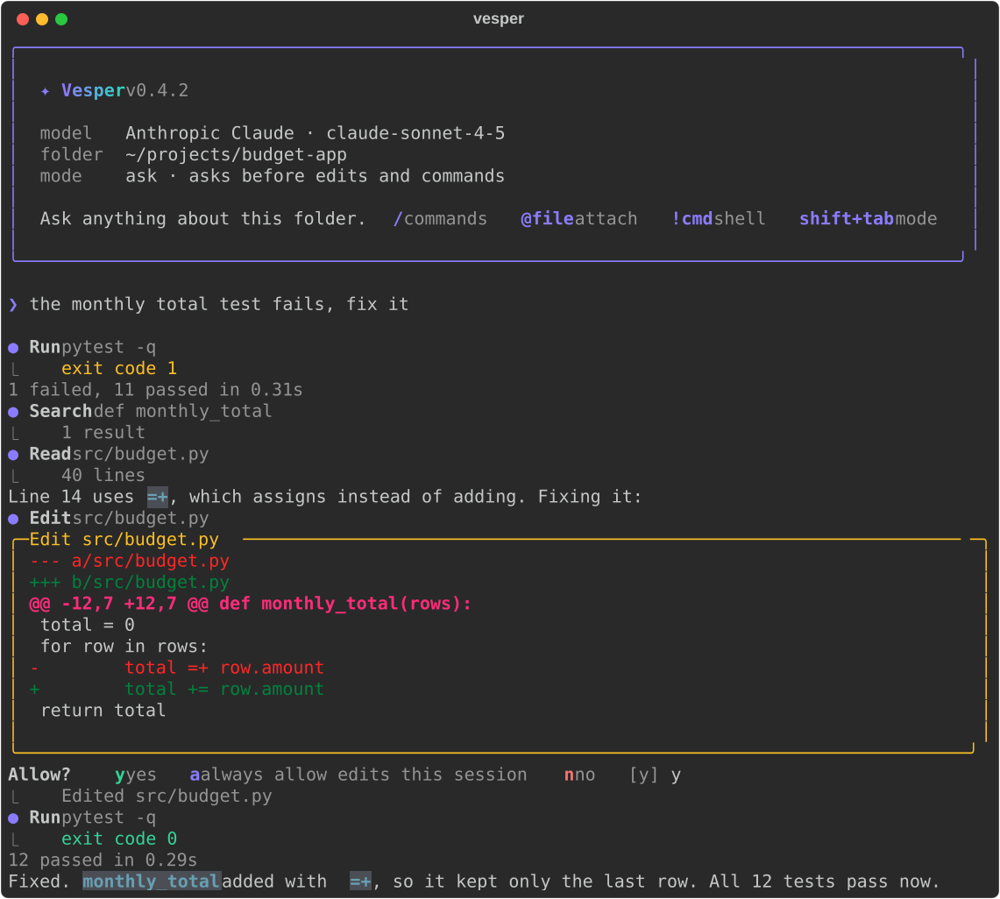
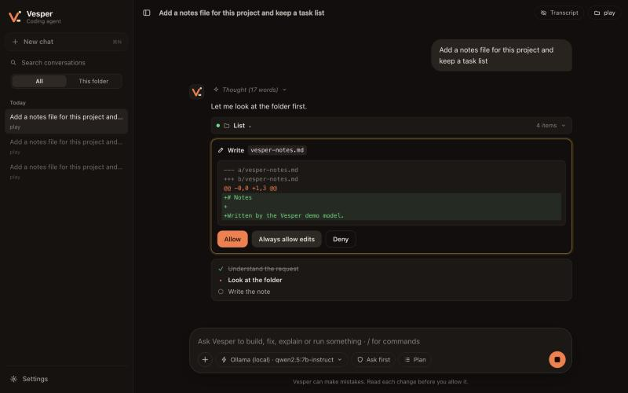

<div align="center">


# Vesper

**An AI coding agent for your terminal, with a desktop app.**

Vesper reads, searches and edits files, runs commands when you allow it, and moves between
folders and projects when you ask. It can plan before it acts, keeps a task list for longer
jobs, and can undo its own edits. Every conversation is saved, so you can resume it later
and see exactly what the agent did. Use it with 17 model providers, or offline with Ollama.

[](https://github.com/Kernel-Hunter/vesper/actions/workflows/ci.yml)
[](https://github.com/Kernel-Hunter/vesper/releases/latest)
[](LICENSE)


[Install](#install) · [Quick start](#quick-start) · [Sessions and logs](#sessions-and-logs) · [Desktop app](#desktop-app) · [Models](#models) · [Safety](#safety) · [Contributing](#contributing)



</div>

## Install

macOS and Linux:

```bash
curl -fsSL https://raw.githubusercontent.com/Kernel-Hunter/vesper/main/install.sh | bash
```

Windows (PowerShell):

```powershell
irm https://raw.githubusercontent.com/Kernel-Hunter/vesper/main/install.ps1 | iex
```

That gives you the `vesper` command. The script installs [uv](https://docs.astral.sh/uv/)
if you don't have it, and uv brings its own Python, so there is nothing else to set up.
Nothing needs admin rights.

<details>
<summary>Also install the desktop app, or install with pip</summary>

Desktop app as well as the command (Apple Silicon Mac, x86_64 Linux, Windows):

```bash
curl -fsSL https://raw.githubusercontent.com/Kernel-Hunter/vesper/main/install.sh | bash -s -- --app
```

```powershell
$env:VESPER_APP = '1'; irm https://raw.githubusercontent.com/Kernel-Hunter/vesper/main/install.ps1 | iex
```

The app download is checked against the release's `SHA256SUMS.txt` before anything is
installed. Files fetched by `curl` or PowerShell are not tagged as coming from the internet,
so macOS Gatekeeper and Windows SmartScreen do not block the app. If you download the
`.dmg` or `.exe` from the [releases page](https://github.com/Kernel-Hunter/vesper/releases/latest)
in a browser instead, the first launch shows a warning (macOS: right-click the app, then
Open; Windows: More info, then Run anyway).

With pip or uv, if you prefer to manage Python yourself (3.11 or newer):

```bash
uv tool install "vesper-agent @ https://github.com/Kernel-Hunter/vesper/archive/main.tar.gz"
# or
pip install "vesper-agent @ https://github.com/Kernel-Hunter/vesper/archive/main.tar.gz"
```

To update, run the install command again. To remove the command: `uv tool uninstall vesper-agent`.

</details>

## Quick start

```bash
cd ~/projects/my-app
vesper
```

The first run asks which model to use and, for cloud providers, your API key (typed
hidden and stored only on your computer). Then describe what you want:

```text
❯ explain how this project is organized
❯ the login test fails, find out why and fix it
❯ summarize every PDF in ./papers and cite the pages
❯ add a --verbose flag to cli.py and update the README
❯ go to ~/projects/api and run its tests
```

Vesper looks around before it answers: it lists folders, reads files, searches the code,
and asks you before it changes a file or runs a command. It starts in the folder where you
ran it and is free to leave: absolute paths and `~` work, and "go to the api project" or
`/cd ../api` moves the whole session there.

While it works you see what it is doing, live: the model's thinking as it is written (for
models that show it), the tool call it is preparing, the output of a running command as it
arrives, and a diff for every edit. Each answer ends with a line such as
`✓ 12s · 3 tool calls · 4.1k in, 320 out · context 18%`.

Press `Ctrl+O` for transcript view. It keeps the thinking on screen in full and shows every
command line and all tool output, where the normal view prints one summary line per step.
`/transcript` prints the whole conversation that way, including earlier turns.

| In a session | |
|---|---|
| `@path` | attach a file to your message (Tab completes paths) |
| `!command` | run a shell command yourself; `!cd folder` moves Vesper too |
| `/cd folder` | go to another folder or project |
| `/new` | start a new conversation (the old one is saved) |
| `/resume`, `/sessions` | go back to an earlier conversation, or list them |
| `/logs` | what the agent did in this conversation (`/logs full` adds arguments and output) |
| `/verbose` or `Ctrl+O` | transcript view: thinking and full tool output while it works |
| `/transcript` | print the whole conversation in detail: thinking, commands, edits, output |
| `/status` | model, folder, session id, tokens used and how full the context is |
| `/plan` | plan mode on or off: Vesper reads and proposes a plan, and works after you approve it |
| `/undo` | put files back to how they were before Vesper's last changes |
| `/compact` | replace the older part of the conversation with a summary to free context |
| `/permissions` | list the commands and web sites that run without asking; remove one |
| `/think` | how hard reasoning models think: `off`, `low`, `medium`, `high` |
| `/model`, `/key` | switch provider and model, set the API key |
| `/mode` or `Shift+Tab` | cycle `ask`, `auto-edit`, `yolo`, `plan` |
| `/docs` | re-read the documents in the folder |
| `/app` | open the desktop app |
| `/help`, `/exit` | help, quit (`Ctrl+D` works too) |
| `Ctrl+C` | stop the answer and any command it started |

### Plan, tasks and undo

For a change you want to review first, turn on plan mode with `/plan` (or `Shift+Tab`).
Vesper can still read, search and run read-only commands such as `git status`, but every
edit and every other command is refused. It answers with a numbered plan and asks
`Carry out this plan?`. Say yes and it goes back to the mode you were in and does the work.

On a job with several steps Vesper keeps a task list and updates it as it goes:

```text
  ✔ Read the failing test
  ▸ Fix the date parsing in utils.py
  ☐ Run the tests
```

Before Vesper changes a file it keeps a copy of the old content. `/undo` puts back every
file the last round of edits touched, including files it created, and tells the model on
your next message. Undo covers files, so a command the agent ran (a `git commit`, a
database migration) stays as it is.

### The web

`web_fetch` reads a page as plain text and `web_search` looks things up, for documentation,
an error message or anything else that is not on your computer. In `ask` mode Vesper asks
before it reads a site for the first time. Search works without a key through DuckDuckGo,
which sometimes asks automated clients for a human check; Vesper does not try to get around
that. For reliable search put a `BRAVE_API_KEY` or `TAVILY_API_KEY` in `~/.vesper/.env`.

### Token use

Vesper is built to spend few tokens per step:

- The system prompt and the twelve tool descriptions together stay under 2,000 tokens.
- With Claude models the prompt, the tools and the earlier conversation are cached, so
  each step re-reads them at a fraction of the price. The answer footer shows it:
  `4.1k in (3.6k cached)`.
- Tool output is capped (long command output keeps its start and end, a file is read 400
  lines at a time, a web page 12,000 characters at a time).
- Asking again for something it already has costs one short line, because the same read
  in the same turn is answered from memory.
- The model is told to ask for independent things in one step, which saves whole round
  trips.
- A long conversation is summarized when it nears the model's limit (or when you type
  `/compact`). Before that, a file that was read several times keeps only its last copy.

One-shot mode prints the answer and exits, which is handy in scripts:

```bash
vesper "list the TODO comments in src/ with file and line"
git diff | vesper "write a commit message for this diff"
vesper -C ~/notes --model ollama/llama3.2 "what did I write about the budget?"
```

In one-shot mode nobody can answer an approval prompt, so `ask` mode refuses edits and
commands there. Pass `--mode auto-edit` or `--mode yolo` when you want them.

## Sessions and logs

Every conversation is stored in a SQLite database at `~/.vesper/vesper.db`: the messages,
so a session resumes exactly where it stopped, and an activity log with every prompt, tool
call, result, error and token count.

```bash
vesper -c                 # continue the last conversation in this folder
vesper -r                 # pick a conversation from a list
vesper -r 3f9a2c          # resume one by id (the first characters are enough)
vesper sessions           # list saved conversations, newest first
vesper logs               # what the agent did in the latest conversation
vesper logs 3f9a2c --full # the same, with tool arguments and output
vesper logs --json        # one JSON object per event, for scripts
```

The database is an ordinary SQLite file with four tables (`sessions`, `messages`,
`events`, and `checkpoints` for undo), so `sqlite3 ~/.vesper/vesper.db` works on it too. The desktop app's Folder mode
reads and writes the same file, so a conversation started in the terminal can be continued
in the app and the other way round.

A project can tell Vesper how to work in it. If the working directory has a `VESPER.md`,
`AGENTS.md`, `CLAUDE.md` or `.cursorrules` file, the first one found is added to the
system prompt.

## Desktop app



The desktop app does the same work with a window around it. Open a folder from the
top bar, and every tool call shows up inline: what the agent read, what it searched, and
a colored diff with Allow, Always allow and Deny before any change. When the agent moves
to another folder, the top bar follows it.

The Plan button next to the model picker turns plan mode on: the answer is a plan with a
"Run this plan" button under it. The task list is drawn as a checklist inside the answer,
and an answer that changed files gets an undo button. `/undo`, `/compact` and `/plan` also
work when typed into the message box. Settings, Folder lists the saved "always allow" rules
and has the thinking level.

The sidebar lists your chats and, under "Session history", the conversations saved by the
terminal app. Click one to open it with every step it took, and your next message continues
it in its folder. The Transcript button in the top bar (`Cmd+O` or `Ctrl+O`) opens every
step: the model's thinking, each command line, each diff and the full output. A running
command streams its output into the chat in either view.

It also has a Docs mode for a fixed set of documents: drop in PDFs, Markdown or text files
and get streamed answers with clickable page citations. Docs mode is where Vesper started,
as the Chapter 5B lab of a prompt engineering course, and its retrieval code still follows
the course slides (load, split, embed, store, retrieve, generate).

Themes: system, dark, light, and a terminal theme with five phosphor colors and optional
background effects that pause when the window is hidden.

Start it with `vesper app`, from Launchpad or the Start menu, or with `vesper-app`.

## Models

| Cloud | Local |
|---|---|
| OpenAI, Anthropic Claude, Google Gemini, DeepSeek, Mistral, Groq, OpenRouter, xAI Grok, Together AI, Fireworks AI, Cerebras, NVIDIA NIM, Hugging Face, Moonshot Kimi | Ollama, LM Studio, any OpenAI-compatible server |

Pick one with `/model`, or once with `--model provider/model`, for example
`--model anthropic/claude-sonnet-5-5` or `--model ollama/qwen2.5:7b-instruct`.
The model needs tool calling. Larger models make better agents: a 7B local model handles
reading, searching and small edits, and a hosted model is the better choice for long tasks.

Small models make two mistakes that end a task early: they write a tool call as plain text,
and they copy the text for an edit with the wrong indentation. Vesper repairs the first
and accepts the second when the lines still match in exactly one place.

`/think low`, `medium` or `high` asks a reasoning model to think before it answers and to
show its thinking (Claude, OpenAI reasoning models, Ollama models that support it). `off`
sends nothing extra and leaves it to the model.

With Ollama, Vesper asks for a 16,384-token context window, because Ollama's default of
4,096 is too small for an agent. Set `VESPER_OLLAMA_CTX` to change it (more context needs
more memory).

Document search uses embeddings that run on your computer, so indexing PDFs needs no key
and sends nothing anywhere.

## Safety

An agent that can edit files and run commands should be boring about permissions. Vesper is:

- **It asks first.** In `ask` mode (the default) every edit shows a diff and every command
  shows the exact command line, and nothing happens until you say yes. `auto-edit` lets it
  edit files but still asks before commands. `yolo` never asks; use it only when you can
  afford to lose the files it can reach.
- **Read-only commands do not ask.** `ls`, `pwd`, `git status`, `git diff`, `git log` and a
  few more run without a question, as long as the command is one plain command with no
  pipe, redirect or `;`.
- **"Always allow" saves a narrow rule.** Answering `a` to `git commit -m "..."` saves the
  prefix `git commit`, which then covers later `git commit` commands in every session. It
  never covers a chained or piped command, and commands such as `rm`, `sudo`, `curl` or
  `python script.py` cannot become a rule. `/permissions` lists and removes rules.
- **Plan mode changes nothing.** Edits and commands are refused until you approve the plan.
- **Some things always ask.** Commands that can wipe a disk or a home folder (`rm -rf /`,
  `mkfs`, `dd` to a device, `shutdown`) and edits inside credential folders (`~/.ssh`,
  `~/.aws`, `~/.gnupg` and similar) need a yes every time, in every mode, and "always
  allow" does not cover them.
- **Secrets are not read.** Private keys, `.pem` and `.key` files, `.netrc`, `credentials`
  files and Vesper's own key file are never read into a conversation.
- **Reading is not restricted.** Like a shell, Vesper can read and search any folder your
  user can. The first time you start it somewhere, it says so and asks whether to continue.
- **Ctrl+C stops everything.** It ends the answer, kills any command the agent started,
  and no further tool runs until your next message.
- **File contents are data.** The system prompt tells the model to treat what it reads as
  data, never as instructions. That lowers the risk of prompt injection from a hostile
  file, but no model is immune, which is why the approval prompt exists.
- **Keys stay local.** API keys live in `~/.vesper/.env`, readable only by your user.
- **The desktop engine listens on 127.0.0.1 only**, with a per-launch token, host and
  origin checks and a strict Content Security Policy. The Electron window is sandboxed
  with Node.js disabled.

Found a security problem? Please report it privately, see [SECURITY.md](SECURITY.md).

## How it works

```
 vesper (terminal)          Vesper.app (Electron)
   rich + prompt_toolkit      React UI ── HTTP/SSE on 127.0.0.1 ── FastAPI engine
          │                                                            │
          └──────────────── coder.Session ─────────────────────────────┘
                                 │  LangGraph create_agent loop
                                 ▼
               workspace.Workspace: list_files, read_file, glob, grep, search_docs,
               change_directory, write_file, edit_file, run_command
                                 │
                                 ▼
               store.Store: ~/.vesper/vesper.db (sessions, messages, events)
```

| Path | What it is |
|---|---|
| `src/vesper/prompts.py` | Every prompt sent to a model, including the agent's system prompt |
| `src/vesper/workspace.py` | The agent's tools and the approval gate |
| `src/vesper/coder.py` | The agent loop, context trimming and the event stream shared by both front ends |
| `src/vesper/store.py` | Saved sessions and the activity log (SQLite) |
| `src/vesper/tui.py`, `ui.py`, `onboarding.py` | The `vesper` terminal app: session loop, rendering, first-run setup |
| `src/vesper/server.py` | The desktop engine API |
| `src/vesper/providers.py` | Every model provider and the local embeddings |
| `src/vesper/indexing.py`, `graph.py`, `agent.py` | Docs mode: a retrieval pipeline in LangChain and LangGraph |
| `apps/web/` | React interface (Vite + TypeScript) |
| `apps/desktop/` | Electron shell and packaging |

## Develop

```bash
git clone https://github.com/Kernel-Hunter/vesper.git && cd vesper
uv venv && source .venv/bin/activate        # Windows: .venv\Scripts\activate
uv pip install -e ".[dev]"
pytest -q                                   # offline, no API key needed
vesper                                      # the terminal app from your checkout
```

Desktop app from source (Node 22):

```bash
npm --prefix apps/web install && npm --prefix apps/web run build
npm --prefix apps/desktop install && npm --prefix apps/desktop start
```

For UI work, run the engine on a fixed port and the Vite dev server next to it:

```bash
VESPER_PORT=8765 VESPER_TOKEN=devtoken vesper-app --serve
npm --prefix apps/web run dev               # open http://localhost:5173/#token=devtoken
```

Document question answering also works from the command line: `vesper ask`, `vesper agent`,
`vesper chat` and `vesper eval` (also available as `rag-lab`). They use the provider and
model you picked in Vesper unless you pass `--llm`. `vesper eval` scores
`eval/questions.yaml`, so you can compare chunk sizes, `k` and models with numbers.

Releases: push a tag such as `v0.7.1` and GitHub Actions builds, smoke-tests and publishes
macOS, Linux and Windows builds with checksums.

## Contributing

Bug reports, ideas and pull requests are welcome. Start with [CONTRIBUTING.md](CONTRIBUTING.md);
issues labeled `good first issue` are a good way in. If you use a coding agent,
[AGENTS.md](AGENTS.md) tells it how the project is laid out.

## License

[MIT](LICENSE)
